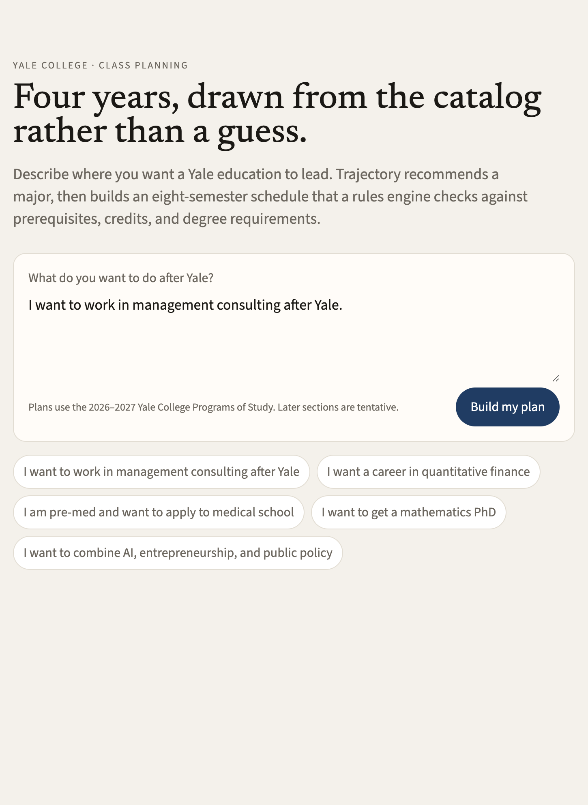
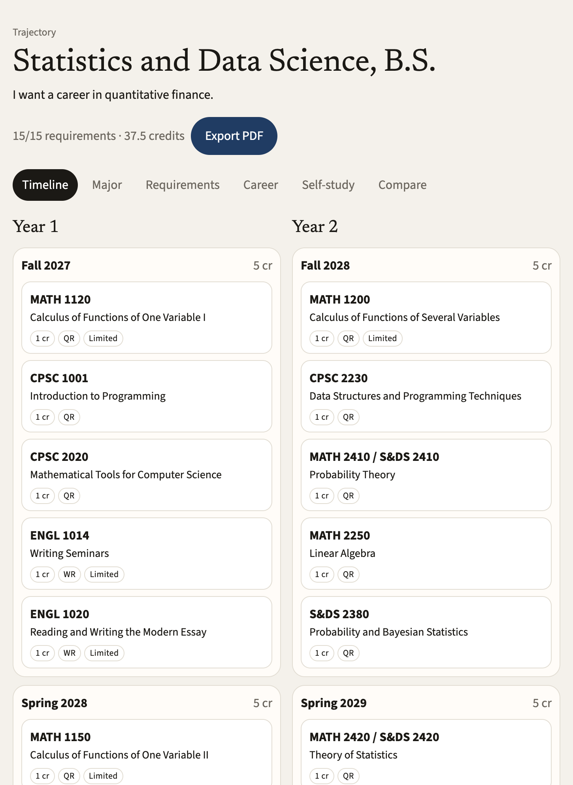

# Trajectory

Trajectory is a four-year academic and career planner for Yale College. A student describes a goal in ordinary language. The app recommends a major, then builds an eight-semester schedule and checks it against Yale's degree rules.

Recommendations come from curated paths grounded in the **Yale College Programs of Study 2026–2027**. A deterministic engine, not the language model, places courses and decides whether a plan is feasible. If `OPENAI_API_KEY` is set, a model may later be used to phrase a rationale; it cannot add a course code that is not in the catalog. Without a key, the app runs entirely on the verified catalog and the built-in paths.

## Screenshots





## Setup

Requirements: Node.js 22 or newer (developed on Node 24) and Python 3, used only to refresh the catalog.

```bash
npm install
npm test
npm run dev
```

Open [http://localhost:3000](http://localhost:3000). Plans are stored in `data/plans.sqlite`, which is created on first use.

To re-download the course lists from the catalog:

```bash
npm run catalog
```

That rewrites `data/catalog/courses.json`. The committed file is what the app and tests use, so the app does not need network access at runtime.

## What a plan contains

- A major recommendation, with alternatives that can be opened as their own plans
- Eight semesters of catalog courses, with credits, distributional designations, and links back to the course list
- A requirements tracker for the major and for the bachelor's degree
- Yale student organizations named in the 2026 Extracurricular Bazaar, plus career milestones
- Self-study that the Yale courses do not cover, with links
- Drag-and-drop between terms, course swap against the catalog, completion tracking, and PDF export

The five paths exercised by `npm test` are management consulting (Economics), quantitative finance (Statistics and Data Science B.S.), pre-med (MCDB B.S.), a mathematics Ph.D. (Mathematics B.A.), and AI with entrepreneurship and public policy (Computer Science B.S.).

## Architecture

| Piece | Role |
| --- | --- |
| `scripts/build_catalog.py` | Downloads CourseLeaf pages and writes the catalog JSON |
| `src/lib/catalog.ts` | Loads courses, credits, designations, and cross-lists |
| `src/lib/prereqs.ts` | Prerequisite rules copied from catalog sentences |
| `src/lib/profiles.ts` | Major checklists, organizations, and self-study |
| `src/lib/engine.ts` | Places courses, fills breadth, and validates the plan |
| `src/lib/store.ts` | SQLite persistence via Node's built-in `node:sqlite` |
| `src/app` | Next.js interface and API |

The engine will not invent a code. If a required course cannot be placed without breaking a prerequisite, a term pattern, the 5.5-credit cap, or the first-year department cap, the plan fails validation. Breadth courses are chosen only from humanities and social-science listings that have no prerequisite sentence.

`npm test` builds every profile, requires zero hard errors, requires at least 36 credits, requires every term to be between 4 and 5.5 credits, and checks that the five career plans do not collapse into the same course list.

## Degree rules the engine enforces

From the 2026–2027 academic regulations:

- 36 course credits for the B.A. or B.S.
- A normal term is four or five credits. Six credits need a dean's permission, so the planner stops at 5.5.
- Distribution: two credits each in humanities and arts, social sciences, sciences, quantitative reasoning, and writing. One course counts toward only one of those.
- Language: the default plan assumes placement into L4, satisfied by one L4 course (SPAN 1400, which is 1.5 credits).
- In the first two terms, at most four credits in one subject.
- Senior-requirement courses stay in the senior year.
- Prerequisites encoded from the catalog must be finished earlier, or in the same term when the catalog says "concurrently" or "to accompany."

Major checklists are the ones published for Economics, Statistics and Data Science, MCDB, MB&B, Mathematics, Applied Mathematics, Computer Science, and Global Affairs.

## Data limitations

These are real limits, not fine print.

- **Future sections are not confirmed.** The plan starts in Fall 2027. The catalog describes 2026–2027. A course on the plan is a catalog listing, not a promise that a section will meet.
- **Credits are often unprinted.** Many course blocks say "0 Course cr" or omit the credit. Yale's rule is that most courses carry one credit and that variations are noted. Explicit 1/2 and 1 1/2 credits are kept. Otherwise the app stores 1.0 and labels that inference. BIOL 1010–1040 are stored as 0.5 because their descriptions say they meet for half a term.
- **A star is not a cancellation.** The YCPS key uses a star for a limited-enrollment seminar. The 2026–2027 pages also star some standard lectures, including MATH 1120. The app keeps the marker and does not drop the course.
- **Brackets mean "not offered this catalog year."** Bracketed courses are avoided.
- **Some requirements are attributes, not course lists.** The YC MATH Distribution attribute and the YC GLBL Elective attribute are not in the parsed course blocks. Those rows stay "needs confirmation" instead of being filled with a guess.
- **Cross-lists are one course.** S&DS 2410 is stored as MATH 2410 because both pages describe the same class. The interface shows both numbers.
- **Organizations** are names and categories from the [2026 Extracurricular Bazaar quick map](https://studentorgs.yale.edu/media/105/download?inline=). The app does not claim what a club did this month.
- **Medical school.** The science list follows [Yale School of Medicine's prerequisite page](https://medicine.yale.edu/md-program/admissions/requirements/) and the MCDB major. BIOL 1010–1040 are not labs. A medical school may still want a biology lab in its own wording. Statistics is recommended now and required for Yale M.D. applicants beginning in the 2027–28 cycle. Confirm the MCAT date with [Yale College health-professions advising](https://advising.yalecollege.yale.edu/preparing-health-care-professions).
- **Recruiting dates** are described as typical and pointed at the [Office of Career Strategy](https://ocs.yale.edu/). They are not a Yale calendar.
- **No deployment** is configured in this repository. Run it locally.

## Sources

- [Requirements for the B.A. or B.S.](https://catalog.yale.edu/ycps/academic-regulations/requirements-for-ba-bs-degree/)
- [Course credits and course loads](https://catalog.yale.edu/ycps/academic-regulations/course-credits-course-loads/)
- [Distributional requirements](https://catalog.yale.edu/ycps/yale-college/distributional-requirements/)
- [Course lists](https://catalog.yale.edu/ycps/courses/)
- [Yale Course Search](https://courses.yale.edu/), which is still the place to confirm a section
